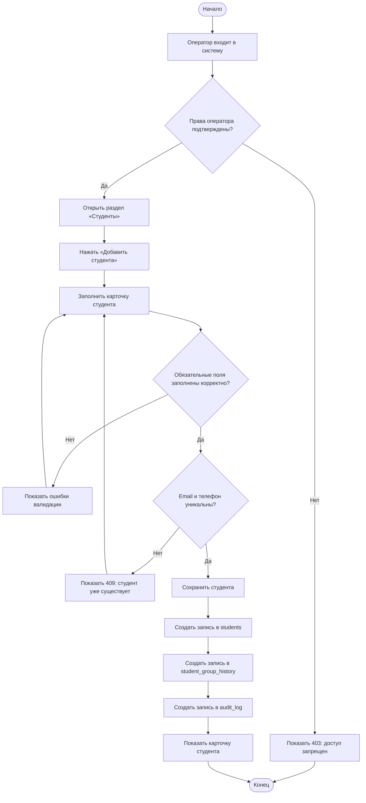

# Анализ предметной области

## 1. Общие сведения

- **Проект:** «Система учета студентов».
- **Предметная область:** учет студентов колледжа, групп и специальностей.
- **Цель анализа:** определить объекты, участников и бизнес-процессы, которые будет автоматизировать разрабатываемое веб-приложение.
- **Основа:** `passport.md`, версия 0.1.0.

## 2. Описание предметной области

В колледже ведется учет студентов: их персональные данные, группа, специальность и статус обучения. Оператор учебной части добавляет новых студентов, редактирует карточки, переводит студентов между группами и формирует отчеты. Студент должен иметь возможность войти в систему и просмотреть только свою карточку. Администратор управляет пользователями, ролями и журналом действий.

Сейчас данные могут вестись в бумажных журналах и разрозненных файлах. Это приводит к дублированию, потере истории изменений и затрудняет поиск. Проект объединяет эти операции в одном веб-приложении с разграничением прав доступа.

**Границы проекта:**

- учитываются студенты, группы, специальности, пользователи, роли, история переводов и журнал действий;
- не включаются расписание занятий, успеваемость, оплата обучения, загрузка документов и уведомления;
- данные о статусе студента хранятся как атрибут карточки, а не как отдельный бизнес-процесс.

## 3. Основные объекты предметной области

| № | Объект | Описание | Ключевые атрибуты |
|---|---|---|---|
| 1 | Студент | Обучающийся, карточка которого ведется в системе | ФИО, дата рождения, email, телефон, группа, статус |
| 2 | Группа | Учебная группа, в которой состоит студент | Название, курс, специальность, куратор |
| 3 | Специальность | Направление подготовки, к которому относится группа | Код, название |
| 4 | Пользователь | Учетная запись для входа в систему | Логин, хеш пароля, роль, активность |
| 5 | Роль | Набор прав доступа пользователя | Код, название |
| 6 | История переводов | Записи о нахождении студента в группах | Студент, группа, дата начала, дата окончания |
| 7 | Запись аудита | След действия пользователя в системе | Пользователь, действие, сущность, идентификатор, дата |

## 4. Участники и роли

| Роль | Участник | Права |
|---|---|---|
| `student` | Студент | Вход в систему, просмотр только своей карточки, смена своего пароля |
| `operator` | Оператор учебной части | Просмотр, создание, редактирование и удаление студентов и групп; просмотр справочников и отчетов |
| `admin` | Администратор | Все права оператора, управление пользователями и ролями, просмотр журнала действий |

## 5. Бизнес-процессы

| ID | Процесс | Триггер | Участник | Результат |
|---|---|---|---|---|
| B1 | Прием нового студента | Поступило заявление и документы | Оператор | Создана карточка студента и запись в истории |
| B2 | Поиск и просмотр карточки | Нужно найти данные студента | Оператор, студент | Найдена карточка студента |
| B3 | Редактирование карточки | Изменились контактные или учебные данные | Оператор | Обновленная карточка и запись аудита |
| B4 | Перевод студента в другую группу | Студент переведен в другую группу | Оператор | Закрыта старая запись истории, создана новая |
| B5 | Формирование отчета | Нужна сводка по группам или статусам | Оператор, администратор | Отчет с агрегированными данными |

## 6. Ключевой процесс: прием нового студента

### 6.1. Входные данные

- фамилия, имя, отчество;
- дата рождения;
- email и телефон;
- группа;
- статус студента;
- данные учетной записи, если студенту нужен вход в систему.

### 6.2. Предусловия

- пользователь авторизован;
- пользователь имеет роль `operator` или `admin`;
- группа существует и доступна для зачисления.

### 6.3. Шаги процесса

1. Оператор входит в систему.
2. Система проверяет JWT и роль пользователя.
3. Оператор открывает раздел «Студенты» и нажимает «Добавить студента».
4. Оператор заполняет карточку студента.
5. Frontend проверяет обязательные поля и форматы email и телефона.
6. Backend повторно проверяет данные и проверяет уникальность email и телефона.
7. Система проверяет существование выбранной группы.
8. В одной транзакции создаются:
   - запись в таблице `students`;
   - запись в таблице `student_group_history` с датой начала обучения;
   - запись в таблице `audit_log`.
9. Система возвращает созданную карточку и показывает сообщение об успехе.

### 6.4. Результат

- создана карточка студента;
- студент закреплен за группой;
- в истории переводов появилась запись;
- действие зафиксировано в журнале аудита.

### 6.5. Исключения

| Ситуация | Реакция системы |
|---|---|
| Не заполнены обязательные поля | Сообщение об ошибке, HTTP 400 |
| Некорректный email или телефон | Сообщение об ошибке, HTTP 400 |
| Студент с таким email или телефоном уже существует | Сообщение о дубликате, HTTP 409 |
| Выбранная группа не найдена | Сообщение об ошибке, HTTP 400 |
| Нет прав на создание | HTTP 403 |
| Ошибка базы данных | Безопасное сообщение, HTTP 500, подробности только в серверном логе |

## 7. Диаграмма бизнес-процесса

Исходник диаграммы: `docs/diagrams/business-process.mmd`. Для сдачи можно отрендерить его в PNG через mermaid.live или diagrams.net.

## 8. Таблица «процесс — проблема — способ автоматизации»

| Процесс | Проблема сейчас | Способ автоматизации |
|---|---|---|
| B1. Прием студента | Ручное заполнение, дубли, потеря данных | Форма с валидацией, проверка уникальности, запись в БД |
| B2. Поиск студента | Поиск по бумажным журналам занимает время | Поиск по ФИО, группе и статусу, фильтрация |
| B3. Редактирование | Данные хранятся в разных файлах | Единая карточка и журнал изменений |
| B4. Перевод в группу | Нет истории переводов, ручная правка списков | История переводов и транзакционное обновление |
| B5. Отчеты | Ручной подсчет и ошибки | SQL-агрегаты и готовые отчеты |

## 9. Предварительная информационная модель

| Связь | Тип | Описание |
|---|---|---|
| `specialties` → `groups` | 1:N | Одна специальность содержит много групп |
| `groups` → `students` | 1:N | В группе состоит много студентов, у студента одна текущая группа |
| `students` ↔ `groups` | M:N | История переводов через `student_group_history` |
| `roles` → `users` | 1:N | Одна роль назначается многим пользователям |
| `students` → `users` | 1:0..1 | Учетная запись может быть связана со студентом |
| `users` → `audit_log` | 1:N | Пользователь совершает много действий |

**Основные правила целостности:**

- email и телефон студента должны быть уникальными;
- группа должна существовать до зачисления студента;
- нельзя удалить группу, если в ней есть студенты;
- запись истории должна содержать студента, группу и дату начала;
- журнал аудита не редактируется и не удаляется пользователями;
- пароль хранится только в виде хеша.

## 10. Выводы для следующих практических работ

- **П3:** на основе процессов B1–B5 сформировать 15 функциональных и 10 нефункциональных требований.
- **П9:** использовать объекты и связи для Use Case и Class Diagram.
- **П10:** преобразовать информационную модель в ER-диаграмму и 7 таблиц.
- **П15:** построить тест-кейсы на прием студента, поиск, перевод, права ролей и ошибки валидации.

## 11. Версия

0.1.0
